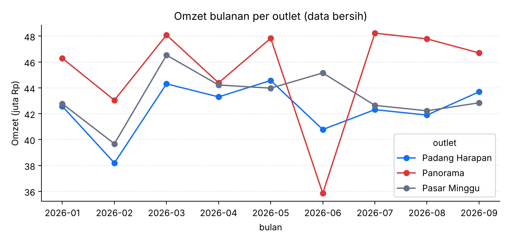
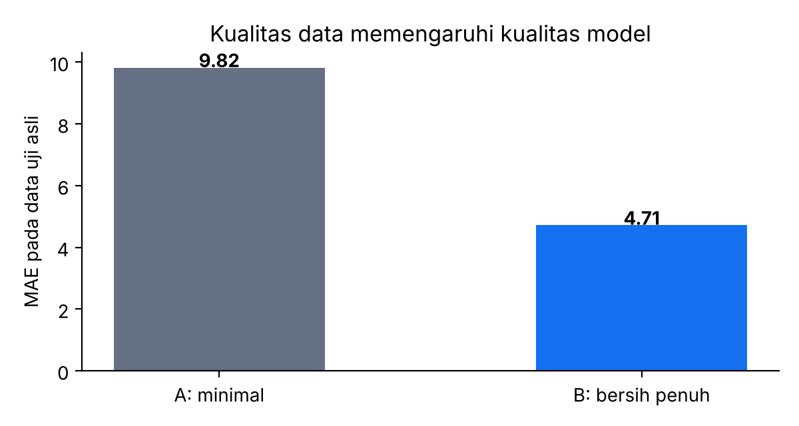

# Pertemuan 1 — Make Sense of Data with Analytics and AI
**Studi Kasus:** Analitik Penjualan Jaringan UMKM Kuliner di Kota Bengkulu

**Identitas**
- Nama: Muhammad Yusuf Arrayyan
- NPM: G1A024009
- Program Studi: S1 Teknik Informatika, Universitas Bengkulu (UNIB)
- Kegiatan: Informatics Practitioner Lecture Series
- Narasumber: peneliti senior BRIN, pengelola tim High Performance Computing (nama pada catatan tulisan tangan kurang terbaca)

> Seluruh data pada notebook ini **sintetis** (dibangkitkan program dengan seed tetap), bukan data usaha yang sebenarnya.

## Ringkasan Materi
Narasumber membahas bagaimana data mentah diolah menjadi informasi dan akhirnya *insight* yang mendukung keputusan bisnis. Poin utama:
1. **CRISP-DM** (Cross-Industry Standard Process for Data Mining) sebagai kerangka kerja proyek data.
2. **Empat jenis analitik:** deskriptif (apa yang terjadi), diagnostik (mengapa terjadi), prediktif (apa yang akan terjadi), preskriptif (apa yang harus dilakukan).
3. **Persiapan data** adalah tahap penentu. Prinsipnya *Garbage In, Garbage Out*: data yang buruk menghasilkan analisis dan model yang buruk. Masalah umum: nilai kosong, duplikat, data tidak konsisten, dan anomali.
4. **Platform analitik berbasis workflow visual** (misalnya KNIME) mempermudah proses tersebut. Generative AI dapat membantu menyusun workflow, tetapi hasil akhir tetap dianalisis dan diputuskan manusia.

## Latar Belakang
Usaha kuliner skala UMKM umumnya mencatat penjualan harian di kasir atau lembar kerja. Pemilik biasanya mengambil keputusan stok dan promosi berdasarkan perasaan, sehingga rawan **kelebihan stok** (bahan terbuang) atau **kehabisan stok** (penjualan hilang). Di sisi lain, data yang tersedia jarang bersih: ada nilai yang kosong, baris yang tercatat dua kali, penulisan nama produk yang berbeda-beda ("Nasi Goreng", "NASI GORENG "), dan angka yang salah ketik.

Studi kasus ini mensimulasikan sebuah jaringan UMKM kuliner dengan 3 outlet dan 4 produk selama 1 Januari sampai 30 September 2026. Tujuannya menunjukkan alur lengkap CRISP-DM dan keempat jenis analitik pada data yang realistis (kotor), sekaligus **membuktikan secara empiris** bahwa kualitas data menentukan kualitas model.

## Rumusan Masalah
1. Bagaimana mengidentifikasi dan membersihkan masalah kualitas data penjualan?
2. Seberapa besar kualitas data memengaruhi akurasi model prediksi?
3. Bagaimana tren omzet tiap outlet, dan apa penyebab penurunan yang mencolok?
4. Berapa kebutuhan stok tiap produk untuk 7 hari ke depan?
5. Apakah diskon promosi layak dijalankan, dan pada besaran berapa?

## Tujuan
1. Menyiapkan data (profil, pembersihan, validasi hasil pembersihan).
2. Menerapkan keempat jenis analitik pada satu kasus yang sama.
3. Membuktikan prinsip *Garbage In, Garbage Out* dengan membandingkan dua model.
4. Menghasilkan rekomendasi keputusan yang dapat ditindaklanjuti pemilik usaha.

## Dasar Teori
- **CRISP-DM** memiliki enam fase: *Business Understanding, Data Understanding, Data Preparation, Modeling, Evaluation, Deployment*. Notebook ini mencakup lima fase pertama dan menutup dengan rekomendasi (fase *Deployment* berupa tindakan bisnis).
- **Deteksi outlier dengan IQR.** Nilai yang melebihi Q3 + 3 × (Q3 − Q1) dianggap pencilan ekstrem (aturan Tukey untuk *far out*) dan ditandai sebagai kosong sebelum diimputasi.
- **Imputasi median per kelompok.** Nilai kosong diisi median untuk kombinasi produk dan akhir pekan, karena median tahan terhadap pencilan.
- **Random Forest Regressor** adalah ansambel pohon keputusan yang memprediksi nilai numerik dengan merata-ratakan prediksi banyak pohon.
- **MAE (Mean Absolute Error)** adalah rata-rata selisih mutlak antara prediksi dan nilai sebenarnya; makin kecil makin baik.
- **Safety stock** `SS = z × σ × √n`. Dengan z = 1,28 (tingkat layanan ±90%), σ simpangan galat prediksi harian, dan n jumlah baris prediksi yang dijumlahkan.
- **Laba kotor skenario diskon** = jumlah terjual × (harga × (1 − diskon) − biaya). Biaya produk diasumsikan 60% dari harga.

## Dataset
| Kolom | Arti |
|---|---|
| `tanggal` | tanggal transaksi (273 hari) |
| `outlet` | Pasar Minggu, Panorama, Padang Harapan |
| `produk` | Nasi Goreng, Mie Ayam, Es Teh, Martabak |
| `qty` | jumlah terjual per hari (target prediksi) |
| `harga` | harga satuan (Rp) |
| `promo` | 1 bila ada promo pada hari itu |
| `hujan` | 1 bila hari hujan |

Data benar berisi 273 hari × 3 outlet × 4 produk = **3.276 baris**. Faktor yang dibangun ke dalam data: akhir pekan menaikkan penjualan, promo menaikkan penjualan, hujan menurunkannya, outlet Panorama sedikit lebih ramai, dan **Panorama direnovasi 10–24 Juni 2026** (penjualan turun). Setelah itu data "dirusak": 4% nilai `qty` dikosongkan, 1% dikali 20 (salah input), 8% label produk ditulis huruf besar dengan spasi, dan 3% baris diduplikasi.

## Metodologi
| Fase CRISP-DM | Bagian notebook |
|---|---|
| Business & Data Understanding | Bagian 1: membangkitkan data dan profil kualitas |
| Data Preparation | Bagian 2: pembersihan dan validasi |
| Analitik deskriptif, diagnostik | Bagian 3 dan 4 |
| Modeling & Evaluation | Bagian 5: Model A (minimal) vs Model B (bersih), diuji pada data asli |
| Aksi bisnis | Bagian 6: stok dan keputusan diskon |

## Implementasi
Seluruh kode ada di `kode.py` dan notebook utama; di bawah ini hasil dan interpretasinya (angka berdasarkan seed bawaan).

> Laporan studi kasus ini dihasilkan otomatis dari narasi di `kode.py`. Kode lengkap: [`Pertemuan_1_Analytics_and_AI.ipynb`](../../Pertemuan_1_Analytics_and_AI.ipynb) ([buka di Colab](https://colab.research.google.com/github/YusufArrayyan/Informatics-Practiticioner-Lecturer-Series/blob/main/Pertemuan_1_Analytics_and_AI.ipynb)) dan [`kode.py`](kode.py). Panduan KNIME: [`KNIME_GUIDE.md`](KNIME_GUIDE.md).

## 1. Business & Data Understanding: membangkitkan data
Data "kebenaran" (`df_true`) dibuat dulu, lalu dirusak secara terkontrol (`df_dirty`) agar kita bisa
mengukur dampak data kotor terhadap model.

### Profil kualitas data (Data Understanding)

### Interpretasi: profil kualitas data
- Data kotor berisi **3.374 baris** (seharusnya 3.276). Ada 135 nilai `qty` kosong (4,0%), **98 baris duplikat penuh**, dan kolom `produk` memiliki **8 nilai unik padahal seharusnya 4** karena penulisan huruf besar/kecil dan spasi berbeda (mis. `'ES TEH '` dan `'Es Teh'`).
- Profil nilai kosong **tidak menampakkan outlier** salah input (angka dikali 20), sehingga outlier perlu dideteksi dengan aturan statistik terpisah. Ini alasan profil data tidak boleh berhenti pada hitungan nilai kosong.

## 2. Data Preparation: membersihkan data
Urutan: standarisasi label → hapus duplikat → tandai outlier (IQR) → imputasi median per kelompok.

### Interpretasi: hasil pembersihan
- Jumlah baris kembali menjadi 3.276 sesuai data benar, dan tidak ada nilai kosong tersisa.
- Karena kita memiliki data asli, hasil pembersihan bisa **divalidasi**: galat rata-rata imputasi hanya sekitar 0,32 unit per baris. Pada kasus nyata data asli tidak tersedia, sehingga validasi dilakukan dengan pemeriksaan wajar (rentang nilai, konsistensi antartabel) dan konfirmasi ke pemilik usaha.

## 3. Analitik #1 — Deskriptif: apa yang terjadi?

### Interpretasi: analitik deskriptif
- Omzet ketiga outlet berada pada kisaran 38–48 juta rupiah per bulan. Panorama umumnya tertinggi karena faktor outlet yang lebih ramai.
- Pada **Juni** omzet Panorama turun tajam menjadi sekitar 35,8 juta, dibanding 47,8 juta (Mei) dan 48,2 juta (Juli). Grafik hanya memberi tahu *bahwa* terjadi penurunan, bukan *penyebabnya*. Itu tugas analitik diagnostik.

## 4. Analitik #2 — Diagnostik: mengapa terjadi?
Cari pekan dengan penurunan omzet terbesar per outlet, lalu uji apakah promo atau hujan menjelaskannya.

### Interpretasi: analitik diagnostik
- Penurunan terdalam terdeteksi pada outlet **Panorama, pekan yang dimulai 15 Juni 2026** (z-score sekitar −3,75). Analisis hanya memakai pekan lengkap 7 hari agar pekan parsial di ujung data tidak terbaca sebagai anomali palsu.
- Pada pekan itu proporsi hari promo **0,57** (normal 0,27), jadi justru lebih tinggi dari biasanya, sedangkan proporsi hari hujan **0,43** (normal 0,38), hanya sedikit di atas normal. Promo menaikkan penjualan, jadi promo tidak menjelaskan penurunan; hujan terlalu kecil perannya.
- Efek faktor secara umum: akhir pekan sekitar +38%, promo sekitar +23%, hujan sekitar −19% terhadap rata-rata penjualan. Karena penurunan Panorama bersifat khas satu outlet, dugaan yang masuk akal adalah **gangguan operasional** (pada data sintetis ini memang renovasi). Diagnostik memberi hipotesis; konfirmasinya tetap lewat investigasi lapangan.

## 5. Analitik #3 — Prediktif + bukti "Garbage In, Garbage Out"
Dua model dilatih pada data yang sama dengan kualitas berbeda, lalu diuji pada **data asli (kebenaran)**
periode Agustus–September 2026.
- **Model A (minimal):** hanya membuang baris kosong; outlier & duplikat dibiarkan (label sudah distandarkan).
- **Model B (bersih):** memakai hasil seluruh langkah pembersihan.

### Interpretasi: prediktif dan Garbage In, Garbage Out
- Dua model memakai algoritma dan data sumber yang sama, hanya kualitas persiapan datanya berbeda, lalu diuji pada **data asli** periode Agustus–September.
- Model A (hanya membuang baris kosong, outlier dan duplikat dibiarkan) memiliki MAE sekitar **9,82**, sedangkan Model B (pembersihan penuh) sekitar **4,71**. Galat turun kira-kira **52%**.
- Pencilan ×20 menyeret model ke nilai yang tidak masuk akal. Bukti ini menegaskan pesan materi: **investasi terbesar ada pada kualitas data, bukan sekadar memilih algoritma yang canggih**.

## 6. Analitik #4 — Preskriptif: apa yang harus dilakukan?
(a) Berapa stok per produk untuk 7 hari ke depan (1–7 Oktober 2026)?
(b) Apakah diskon promo layak dijalankan? (asumsi biaya produk 60% dari harga)

### Interpretasi: analitik preskriptif
- **Stok 1–7 Oktober 2026** (prediksi + safety stock): Es Teh ±1.101, Nasi Goreng ±733, Mie Ayam ±613, Martabak ±376 porsi/unit untuk seluruh outlet. Produk dengan permintaan tinggi memerlukan stok terbesar, dan safety stock melindungi dari lonjakan di atas prediksi.
- **Diskon:** model menaksir promo menaikkan volume sekitar ×1,24. Dengan biaya produk 60% dari harga, laba kotor mingguan: tanpa diskon ±14,18 juta; diskon 5% ±15,34 juta (**naik ±8%**); diskon 10% ±13,15 juta; diskon 15% ±10,96 juta. Artinya diskon kecil menguntungkan, tetapi diskon besar justru menggerus laba karena kenaikan volume tidak sebanding dengan pemotongan margin.
- **Catatan penting:** analisis mengasumsikan kenaikan volume tetap ×1,24 untuk semua besaran diskon. Dalam praktik, diskon yang lebih besar bisa menaikkan volume lebih besar. Karena itu hasil ini dipakai sebagai hipotesis yang **diuji dengan A/B test** sebelum diterapkan.

## Ringkasan
| Jenis analitik | Pertanyaan | Hasil di notebook |
|---|---|---|
| Deskriptif | Apa yang terjadi? | Omzet bulanan per outlet |
| Diagnostik | Mengapa? | Penurunan outlet tertentu bukan akibat promo/hujan |
| Prediktif | Apa yang akan terjadi? | Prediksi qty harian (Random Forest) |
| Preskriptif | Apa yang dilakukan? | Rekomendasi stok & kelayakan diskon |

## Hasil dan Pembahasan (ringkasan)
| Analitik | Temuan |
|---|---|
| Persiapan data | Data kotor (4% kosong, 1% outlier, 8% label tidak konsisten, 3% duplikat) pulih ke 3.276 baris dengan galat imputasi ±0,32 |
| Deskriptif | Omzet outlet 38–48 juta per bulan; Panorama turun tajam pada Juni |
| Diagnostik | Penurunan khas satu outlet (pekan 15 Juni), bukan akibat promo atau hujan |
| Prediktif | MAE 4,71 (data bersih) vs 9,82 (pembersihan minimal): galat turun ±52% |
| Preskriptif | Rekomendasi stok per produk; diskon 5% paling menguntungkan di antara opsi yang diuji |

## Kesimpulan
1. Alur CRISP-DM dan empat jenis analitik dapat dijalankan end-to-end pada satu kasus nyata-sintetis, dari data kotor sampai rekomendasi keputusan.
2. Kualitas data menentukan kualitas model: pembersihan penuh menurunkan galat prediksi sekitar separuhnya.
3. Analitik deskriptif menunjukkan *apa*, diagnostik memberi hipotesis *mengapa*, prediktif menaksir *apa yang akan terjadi*, dan preskriptif mengubahnya menjadi *tindakan*. Keempatnya saling melengkapi.
4. Keputusan akhir tetap berada di tangan manusia: model memberi rekomendasi, bukan perintah.

## Keterbatasan
- Data sintetis dibangun dari rumus yang kita tetapkan, sehingga model "menemukan" pola yang memang ditanam. Performa pada data usaha sungguhan akan berbeda.
- Cakupan waktu hanya 9 bulan, tanpa efek musiman tahunan (Ramadan, libur panjang).
- Analisis diskon mengandalkan asumsi biaya produk dan kenaikan volume yang tetap.

## Saran Pengembangan
- Menambahkan fitur harga pesaing, cuaca nyata (BMKG), dan kalender hari besar.
- Mencoba model deret waktu (mis. gradient boosting dengan fitur lag) dan membandingkannya dengan Random Forest.
- Menyusun workflow yang sama di **KNIME** (lihat `KNIME_GUIDE.md`) agar pemilik usaha dapat mengulang analisis tanpa menulis kode.
- Menjalankan A/B test promo sebelum keputusan diskon.

## Referensi
> Rujukan di bawah adalah bacaan lanjutan. Periksa kembali penulisan, tahun, dan volume sebelum dikutip dalam laporan resmi.
- Chapman, P., dkk. (2000). *CRISP-DM 1.0: Step-by-step data mining guide*. SPSS Inc.
- Breiman, L. (2001). Random Forests. *Machine Learning*, 45(1), 5–32.
- Pedregosa, F., dkk. (2011). Scikit-learn: Machine Learning in Python. *Journal of Machine Learning Research*, 12, 2825–2830.
- Tukey, J. W. (1977). *Exploratory Data Analysis*. Addison-Wesley.
- Materi Practitioner Lecture Series, Pertemuan 1 (catatan kuliah).

## Lampiran: Gambar Hasil

**01_deskriptif_omzet_bulanan**

**02_prediktif_garbage_in_out**

