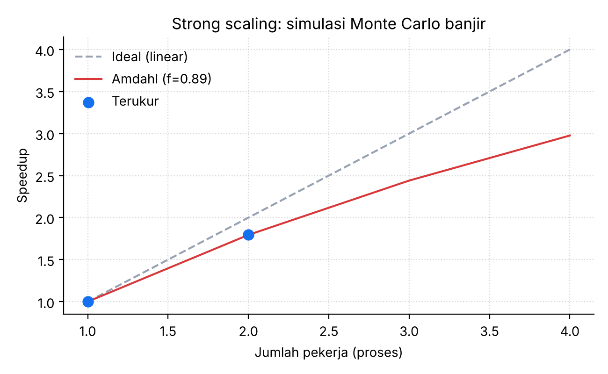

# Pertemuan 2 — Bridging Global Infrastructure to Address Local Challenge with HPC
**Studi Kasus:** Simulasi Monte Carlo Risiko Banjir secara Serial dan Paralel

**Identitas**
- Nama: Muhammad Yusuf Arrayyan
- NPM: G1A024009
- Program Studi: S1 Teknik Informatika, Universitas Bengkulu (UNIB)
- Kegiatan: Informatics Practitioner Lecture Series
- Narasumber: Asst. Prof. Dr. Worawan Diaz Carballo, Thammasat University, Thailand (ejaan nama dari catatan tulisan tangan)

> Model hujan pada notebook ini adalah **model mainan** untuk mendemonstrasikan komputasi paralel, bukan model hidrologi yang dikalibrasi.

## Ringkasan Materi
1. Di era AI dan data besar, **komputasi berkinerja tinggi (High Performance Computing, HPC)** menjadi penting untuk simulasi, pemodelan, dan pelatihan model AI skala besar yang tidak praktis dijalankan di komputer biasa.
2. Infrastruktur HPC global dapat dimanfaatkan untuk menjawab **masalah lokal**, misalnya sains iklim dan cuaca, pertanian, serta kesehatan, melalui akses bersama dan kolaborasi lintas negara.
3. Pengembangan kapasitas: pelatihan (*bootcamp*), kompetisi HPC-AI, dan kolaborasi regional ASEAN, termasuk gambaran superkomputer dunia dan infrastruktur nasional.
4. Pesan bagi mahasiswa: HPC bisa dipelajari bertahap, dimulai dari konsep paralelisme sebelum naik ke klaster dan kompetisi.

## Latar Belakang
Bengkulu dan banyak daerah di Indonesia menghadapi risiko banjir akibat hujan ekstrem. Menaksir **peluang hujan ekstrem melampaui kapasitas drainase** membutuhkan simulasi *Monte Carlo*: ribuan hingga jutaan skenario badai dibangkitkan secara acak, lalu dihitung berapa persen yang menyebabkan banjir. Makin banyak skenario, makin stabil estimasinya, tetapi waktu hitung ikut membesar.

Karakteristik pentingnya: tiap skenario **saling bebas**, sehingga pekerjaan ini disebut *embarrassingly parallel* dan sangat cocok dibagi ke banyak inti prosesor. Inilah jembatan antara konsep HPC dari narasumber dan masalah lokal: dengan membagi kerja, simulasi yang lama dapat diselesaikan jauh lebih cepat.

## Rumusan Masalah
1. Bagaimana mengestimasi peluang banjir dengan simulasi Monte Carlo?
2. Seberapa besar percepatan (*speedup*) yang diperoleh dengan membagi simulasi ke beberapa proses?
3. Apa yang membatasi percepatan tersebut (hukum Amdahl)?
4. Bagaimana perilaku sistem jika beban dan jumlah inti sama-sama dinaikkan (*weak scaling*)?

## Tujuan
1. Mengimplementasikan simulasi Monte Carlo serial dan paralel.
2. Mengukur speedup dan efisiensi, serta mengestimasi porsi paralel program.
3. Membedakan *strong scaling* dan *weak scaling*.
4. Mengekstrapolasi waktu hitung untuk simulasi yang jauh lebih besar.

## Dasar Teori
- **Speedup** `S(p) = T1 / Tp`, dengan T1 waktu pada satu pekerja dan Tp waktu pada p pekerja. **Efisiensi** `E(p) = S(p) / p`.
- **Hukum Amdahl:** `S(p) = 1 / ((1 − f) + f/p)`, dengan f porsi program yang dapat diparalelkan. Bagian serial (1 − f) membatasi percepatan maksimum menjadi `1/(1 − f)`, berapa pun jumlah intinya.
- **Strong scaling:** beban total tetap, jumlah inti ditambah. **Weak scaling:** beban per inti tetap, sehingga beban total tumbuh bersama jumlah inti; idealnya waktu tetap konstan.
- **Monte Carlo:** estimasi probabilitas dari proporsi kejadian pada banyak sampel acak; galat menurun sebanding 1/√N.
- **multiprocessing (Python):** membuat banyak proses terpisah sehingga tidak dibatasi *Global Interpreter Lock*.

## Dataset dan Model
Tidak ada dataset eksternal; data dibangkitkan oleh simulasi. Satu skenario adalah badai 72 jam:
- intensitas badai ~ lognormal (σ = 0,6) sebagai pengali,
- hujan per jam ~ gamma (shape 0,35; skala 9 mm),
- banjir terjadi bila hujan **6 jam berturut-turut melebihi 150 mm** (ambang drainase asumsi).

## Metodologi
1. Fungsi `simulasi_chunk` menjalankan sebagian skenario pada satu proses.
2. `jalankan` membagi total skenario ke p pekerja dan mengukur waktu terbaik dari 3 percobaan.
3. Strong scaling: N tetap, p = 1, 2, … hingga jumlah inti tersedia.
4. Estimasi f dari hukum Amdahl, lalu bandingkan kurva teoritis dengan hasil ukur.
5. Weak scaling: N dikalikan p.
6. Ekstrapolasi waktu untuk 10 juta dan 100 juta skenario.

## Implementasi
Waktu hitung bergantung pada mesin (jumlah inti, beban lain di sistem), sehingga angka pada sel **Interpretasi** di bawah adalah *contoh* dari satu kali jalan pada mesin 2 inti, bukan nilai tetap.

> Laporan studi kasus ini dihasilkan otomatis dari narasi di `kode.py`. Kode lengkap: [`Pertemuan_2_HPC.ipynb`](../../Pertemuan_2_HPC.ipynb) ([buka di Colab](https://colab.research.google.com/github/YusufArrayyan/Informatics-Practiticioner-Lecturer-Series/blob/main/Pertemuan_2_HPC.ipynb)) dan [`kode.py`](kode.py). Panduan KNIME: [`KNIME_GUIDE.md`](KNIME_GUIDE.md).

## 1. Model simulasi (satu "pekerja")
Tiap skenario = badai 72 jam. Banjir terjadi bila curah hujan 6 jam berturut-turut melebihi ambang drainase.

## 2. Strong scaling: beban tetap, inti ditambah

### Interpretasi: strong scaling
- **Peluang banjir** hasil simulasi sekitar 4,6% (4,62% dengan 1 pekerja, 4,60% dengan 2 pekerja). Nilainya hampir sama karena yang berubah hanya cara pembagian kerja, bukan modelnya. Selisih kecil muncul karena setiap pekerja memakai seed yang berbeda.
- Pada contoh jalan di mesin 2 inti, waktu turun dari ±2,40 detik (1 pekerja) menjadi ±1,22 detik (2 pekerja): speedup ±1,96× dan efisiensi ±0,98. Hasilnya mendekati ideal (2×) tetapi tidak sempurna karena ada biaya membuat proses dan mengumpulkan hasil.
- **Angka waktu bergantung pada mesin** dan beban sistem saat dijalankan. Di Colab atau laptop lain hasilnya akan berbeda; yang konsisten adalah polanya: waktu turun dan efisiensi sedikit di bawah 1.

## 3. Hukum Amdahl: estimasi porsi paralel
$S(p) = \dfrac{1}{(1-f) + f/p}$ dengan $f$ = porsi program yang dapat diparalelkan.
Dari tiap pengukuran dengan $p>1$: $f = \dfrac{1 - 1/S}{1 - 1/p}$.

### Interpretasi: hukum Amdahl
- Porsi paralel f yang terestimasi sekitar 0,98 pada contoh jalan. Artinya hanya ±2% program bersifat serial (pembagian tugas, pembuatan proses, penggabungan hasil).
- Batas percepatan teoritis `1/(1 − f)` sekitar 45,8× berapa pun jumlah inti. Inilah inti hukum Amdahl: **menambah inti memberi hasil yang makin menurun jika ada bagian serial**, sehingga mengurangi bagian serial sama pentingnya dengan menambah perangkat keras.
- Estimasi f dihitung dari satu titik data (p = 2) sehingga sangat sensitif terhadap derau pengukuran waktu. Pada eksekusi lain nilainya bisa berkisar sekitar 0,9–1,0. Jalankan di mesin dengan lebih banyak inti untuk estimasi yang lebih andal.

## 4. Weak scaling: beban tumbuh sebanding jumlah inti
Idealnya waktu tetap konstan. Efisiensi = $T_1 / T_p$.

### Interpretasi: weak scaling
- Pada weak scaling, beban per inti tetap (200.000 skenario per pekerja), sehingga waktu idealnya konstan. Pada contoh jalan, 1 pekerja dengan 200.000 skenario memerlukan ±0,76 detik dan 2 pekerja dengan 400.000 skenario ±0,88 detik: **efisiensi weak scaling ±0,86**.
- Efisiensi di bawah 1 mencerminkan overhead (pembuatan proses, pengumpulan hasil). Pada klaster nyata, **komunikasi antarnode** dan I/O menjadi penyebab utama.

## 5. Apa artinya untuk masalah lokal?
Dengan kecepatan hasil di atas, kita bisa menghitung perkiraan waktu untuk simulasi yang jauh lebih besar.

### Interpretasi: dari lokal ke skala HPC
- Simulasi 10 juta skenario memerlukan ±0,7 menit secara serial dan ±0,3 menit dengan 2 inti; 100 juta skenario ±6,7 menit serial dan ±3,4 menit dengan 2 inti (ekstrapolasi dari waktu terukur).
- Model nyata (resolusi tinggi, banyak variabel) bisa ribuan kali lebih berat. Pembagian kerja ke ratusan atau ribuan inti pada klaster HPC mengubah waktu hitung dari hari menjadi jam.
- Itulah makna "menjembatani infrastruktur global untuk tantangan lokal": daerah dapat menjalankan simulasi besar tanpa memiliki superkomputer sendiri, asalkan memahami cara membagi pekerjaan.

## Ringkasan
- Masalah *embarrassingly parallel* (skenario saling bebas) cocok untuk HPC.
- Speedup nyata < ideal karena bagian serial (pembagian tugas, pengumpulan hasil, overhead proses).
- Hukum Amdahl memberi batas atas percepatan; strong vs weak scaling menjawab pertanyaan berbeda.

## Hasil dan Pembahasan (ringkasan)
| Aspek | Temuan |
|---|---|
| Estimasi peluang banjir | ±4,6%, konsisten pada semua konfigurasi pekerja |
| Strong scaling | Speedup ±1,96× pada 2 inti (efisiensi ±0,98); makin banyak inti, efisiensi makin turun karena bagian serial |
| Hukum Amdahl | Porsi paralel ±0,98 membatasi speedup maksimum teoritis ±46× (sensitif terhadap derau waktu) |
| Weak scaling | Efisiensi ±0,86 pada 2 inti; turun oleh overhead |

## Kesimpulan
1. Simulasi Monte Carlo yang saling bebas sangat cocok diparalelkan dan memberi percepatan nyata.
2. Percepatan dibatasi bagian serial program (hukum Amdahl), sehingga hasil tidak pernah sepenuhnya linear.
3. Strong dan weak scaling menjawab pertanyaan berbeda: "seberapa cepat beban tetap selesai" vs "seberapa besar beban yang dapat ditangani".
4. Konsep ini menjadi dasar memanfaatkan infrastruktur HPC untuk masalah lokal seperti risiko bencana.

## Keterbatasan
- Percobaan berjalan pada satu mesin dengan memori bersama; klaster sungguhan memiliki komunikasi jaringan antarnode.
- Hasil waktu bervariasi antarmesin dan antarjalan karena beban sistem lain.
- Model hujan sangat disederhanakan; hasilnya tidak untuk keputusan mitigasi nyata.

## Saran Pengembangan
- Mengganti model mainan dengan model hidrologi sederhana yang dikalibrasi data curah hujan (BMKG).
- Mencoba `mpi4py` atau Dask untuk membagi kerja antarmesin, lalu menjalankannya di klaster kampus atau layanan HPC nasional/regional.
- Mengikuti pelatihan dan kompetisi HPC-AI seperti yang disebut narasumber.
- Menyusun workflow paralel di KNIME dengan *Parallel Chunk Start/End* (lihat `KNIME_GUIDE.md`).

## Referensi
> Rujukan di bawah adalah bacaan lanjutan. Periksa kembali penulisan, tahun, dan volume sebelum dikutip dalam laporan resmi.
- Amdahl, G. M. (1967). Validity of the single processor approach to achieving large scale computing capabilities. *AFIPS Spring Joint Computer Conference*.
- Gustafson, J. L. (1988). Reevaluating Amdahl's Law. *Communications of the ACM*, 31(5), 532–533.
- Metropolis, N., & Ulam, S. (1949). The Monte Carlo method. *Journal of the American Statistical Association*, 44(247), 335–341.
- Dokumentasi Python: modul `multiprocessing`.
- Materi Practitioner Lecture Series, Pertemuan 2 (catatan kuliah).

## Lampiran: Gambar Hasil

**02_strong_scaling_amdahl**

