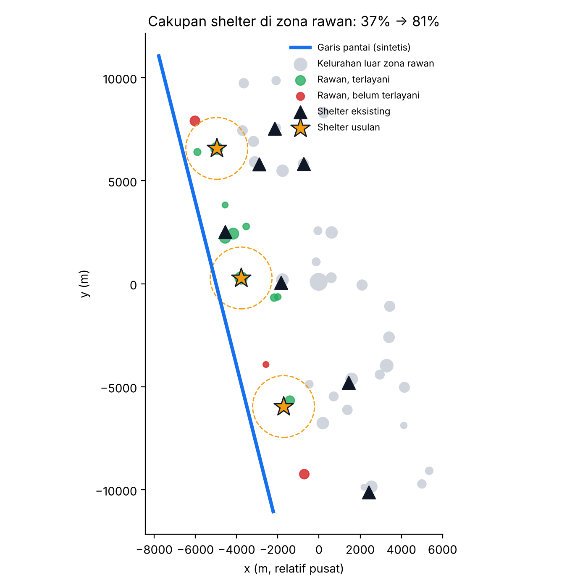

# Pertemuan 3 — Career and Competition in Indonesia with GIS
**Studi Kasus:** Penentuan Titik Evakuasi Tambahan di Zona Pesisir Rawan Tsunami dan Klasifikasi Tutupan Lahan

**Identitas**
- Nama: Muhammad Yusuf Arrayyan
- NPM: G1A024009
- Program Studi: S1 Teknik Informatika, Universitas Bengkulu (UNIB)
- Kegiatan: Informatics Practitioner Lecture Series
- Narasumber: praktisi GIS (nama pada catatan tulisan tangan kurang terbaca)

> Lokasi, populasi, dan garis pantai pada notebook ini **sintetis** untuk mendemonstrasikan metode. Untuk keputusan kebencanaan nyata gunakan data resmi (BPBD, BIG, BMKG).

## Ringkasan Materi
1. **GIS (Sistem Informasi Geografis)** berkembang menjadi fondasi *Smart City*, logistik dan rantai pasok, serta layanan publik; GIS dipakai untuk analisis geografis dan optimasi lokasi.
2. Prospek **karier GIS di Indonesia** dan lanskap persaingannya: instansi pemerintah, industri, dan konsultan pemetaan.
3. Keterampilan yang didorong: perangkat open source profesional (**QGIS, PostGIS, GeoPandas**), pemrosesan data besar lewat **cloud computing (Google Earth Engine)**, dan integrasi **machine learning** seperti klasifikasi tutupan lahan.
4. Pesan: kompetensi data spasial makin dicari, dan perpaduan GIS dengan data science memberi keunggulan.

## Latar Belakang
Kota Bengkulu berada di pesisir barat Sumatra yang menghadap Samudra Hindia, wilayah dengan sejarah gempa dan potensi tsunami. Salah satu aspek kesiapsiagaan adalah **ketersediaan titik evakuasi (shelter) yang dapat dijangkau penduduk dalam waktu singkat**. Pertanyaan praktisnya: kelurahan mana di zona pesisir yang belum terlayani, dan di mana sebaiknya shelter tambahan ditempatkan?

Pertanyaan ini bersifat spasial: jawabannya bergantung pada jarak, populasi, dan letak garis pantai. Karena itu GIS menjadi alat yang tepat, dan keterampilan menjawabnya (jarak, *buffer*, cakupan layanan, optimasi lokasi) sejalan dengan kompetensi yang dibahas narasumber untuk karier GIS. Bagian kedua studi kasus mengambil keterampilan lain dari materi: **klasifikasi tutupan lahan** dari citra satelit multispektral dengan machine learning.

## Rumusan Masalah
1. Kelurahan mana yang berada di zona rawan dan berapa penduduknya?
2. Berapa persen penduduk zona rawan yang terlayani shelter eksisting dalam jarak jalan kaki?
3. Di mana lokasi shelter tambahan yang paling efektif menaikkan cakupan?
4. Bagaimana mengklasifikasikan tutupan lahan dari citra multispektral, dan kelas mana yang sulit dibedakan?

## Tujuan
1. Menerapkan operasi analisis spasial dasar: jarak, zona *buffer*, cakupan layanan.
2. Mengoptimalkan lokasi shelter baru dengan K-Means berbobot populasi.
3. Mengekspor hasil ke **GeoJSON** agar dapat dibuka di QGIS.
4. Mengklasifikasikan lima kelas tutupan lahan dengan Random Forest memakai indeks spektral NDVI, NDWI, dan NDBI.

## Dasar Teori
- **Hukum pertama geografi (Tobler):** segala sesuatu saling berhubungan, tetapi yang berdekatan lebih berhubungan. Dasar logika bahwa jarak ke shelter memengaruhi keterjangkauan.
- **Sistem koordinat:** koordinat lintang/bujur (WGS84) dikonversi ke meter dengan proyeksi lokal agar jarak bermakna dalam meter. Pada GeoPandas, CRS metrik yang sesuai untuk Bengkulu adalah **EPSG:32748** (UTM zona 48 selatan).
- **Buffer dan cakupan layanan:** area dalam radius tertentu dari suatu titik. Kelurahan dianggap terlayani bila jarak ke shelter terdekat ≤ 1,5 km (asumsi ±20 menit berjalan kaki).
- **K-Means berbobot:** mengelompokkan titik dengan bobot (populasi) sehingga pusat klaster tertarik ke area berpenduduk padat.
- **Indeks spektral:** `NDVI = (NIR − Red)/(NIR + Red)` untuk vegetasi, `NDWI = (Green − NIR)/(Green + NIR)` untuk air, `NDBI = (SWIR − NIR)/(SWIR + NIR)` untuk lahan terbangun. Pada Sentinel-2: B2 biru, B3 hijau, B4 merah, B8 NIR, B11 SWIR.

## Dataset
- **Kelurahan:** 45 titik sintetis (lat, lon, populasi, jarak ke pantai).
- **Garis pantai:** garis lurus miring di sisi barat (penyederhanaan).
- **Shelter eksisting:** 7 titik.
- **Piksel tutupan lahan:** 300 sampel per kelas (Hutan, Sawit, Permukiman, Air, Lahan Terbuka) dengan reflektansi B2, B3, B4, B8, B11 dan derau pengukuran.

## Metodologi
1. Bangun data spasial dan hitung jarak ke pantai.
2. Tentukan zona rawan (≤ 3 km dari pantai) dan jarak ke shelter terdekat.
3. Hitung cakupan penduduk terlayani sebelum penambahan shelter.
4. Tempatkan 3 shelter baru dengan K-Means berbobot, lalu hitung ulang cakupan.
5. Petakan hasil dan ekspor GeoJSON; padanan GeoPandas bersifat opsional.
6. Klasifikasikan piksel dengan Random Forest dan evaluasi.

## Implementasi
Angka pada sel **Interpretasi** berdasarkan seed bawaan.

> Laporan studi kasus ini dihasilkan otomatis dari narasi di `kode.py`. Kode lengkap: [`Pertemuan_3_GIS.ipynb`](../../Pertemuan_3_GIS.ipynb) ([buka di Colab](https://colab.research.google.com/github/YusufArrayyan/Informatics-Practiticioner-Lecturer-Series/blob/main/Pertemuan_3_GIS.ipynb)) dan [`kode.py`](kode.py). Panduan KNIME: [`KNIME_GUIDE.md`](KNIME_GUIDE.md).

## 1. Data spasial sintetis di sekitar Kota Bengkulu
Koordinat disimpan dalam derajat (WGS84), lalu diproyeksikan ke meter (proyeksi lokal ekuirektangular)
agar jarak dalam meter. Garis pantai disederhanakan sebagai garis lurus miring di sisi barat.

## 2. Analisis spasial: zona rawan, jarak ke shelter, cakupan layanan
- Zona rawan = jarak ke pantai ≤ 3 km
- Terlayani = shelter terdekat ≤ 1,5 km (asumsi jarak tempuh jalan kaki ±20 menit)

### Interpretasi: kondisi awal
- Dari 45 kelurahan, **14** berada di zona rawan (≤ 3 km dari pantai) dengan total sekitar **47.800 penduduk**.
- Hanya **37,3%** penduduk zona rawan yang berada dalam 1,5 km dari shelter eksisting. Sisanya (±62,7%) belum terlayani.
- Daftar kelurahan terbesar yang belum terlayani (mis. Kelurahan-30 dan Kelurahan-39 dengan populasi >6.000 jiwa) menjadi kandidat prioritas karena jumlah penduduk terdampak besar.

## 3. Optimasi lokasi: K-Means berbobot populasi
Titik shelter baru ditempatkan di pusat massa kelompok kelurahan yang belum terlayani, lalu
di-*snap* ke kelurahan terdekat agar berada di area permukiman.

### Interpretasi: hasil optimasi lokasi
- Penambahan **3 shelter usulan** menaikkan cakupan dari 37,3% menjadi **80,6%** (naik ±43 poin persentase).
- Lokasi usulan dipilih dengan K-Means berbobot populasi lalu di-*snap* ke kelurahan terdekat agar berada di area permukiman, bukan di laut atau lahan kosong.
- Ini usulan awal berbasis jarak. Keputusan nyata perlu mempertimbangkan kapasitas bangunan, ketinggian tanah, kondisi jalan, dan jalur evakuasi.

## 4. Peta hasil + ekspor GeoJSON untuk QGIS

### Interpretasi: peta dan interoperabilitas
- Peta menampilkan kelurahan rawan yang terlayani (hijau), yang belum terlayani (merah), shelter eksisting (segitiga), dan shelter usulan (bintang) beserta radius layanan 1,5 km.
- Berkas **GeoJSON** dapat dibuka di QGIS (*Layer → Add Layer → Add Vector Layer*) dan dikelompokkan berdasarkan atribut `jenis`. Ini contoh bagaimana hasil analisis kode dibawa ke perangkat GIS desktop yang dibahas materi.

### Opsional: padanan GeoPandas
Sel ini hanya berjalan bila `geopandas` terpasang (sudah tersedia di Google Colab). Operasi *buffer* 1,5 km
dilakukan pada CRS metrik **EPSG:32748** (UTM zona 48 selatan, yang mencakup Bengkulu).

## 5. Klasifikasi tutupan lahan dari citra multispektral (setara alur GEE + ML)
Sampel piksel sintetis (reflektansi Sentinel-2: B2, B3, B4, B8, B11) untuk 5 kelas.
Fitur turunan: NDVI, NDWI, NDBI.

### Interpretasi: klasifikasi tutupan lahan
- Akurasi pada data uji sekitar **94,4%**. Kelas **Air** terpisah sempurna karena reflektansi NIR dan SWIR-nya sangat rendah.
- Kesalahan terbesar terjadi pada pasangan **Hutan ↔ Sawit** (spektral keduanya mirip: sama-sama vegetasi lebat) dan **Permukiman ↔ Lahan Terbuka** (sama-sama tidak bervegetasi). Pada citra nyata, pembeda yang sering ditambahkan adalah **deret waktu** (pola musiman/panen) dan **tekstur** atau bentuk lahan.
- Fitur yang paling berpengaruh adalah B11 (SWIR) dan B8 (NIR), karena keduanya paling membedakan vegetasi, air, dan tanah terbuka.

## Ringkasan
- Operasi inti GIS (jarak, buffer, cakupan, *snap*) dapat dijalankan sebagai kode dan hasilnya diekspor ke QGIS.
- Optimasi sederhana (K-Means berbobot populasi) memberi usulan awal yang dapat dikaji pakar.
- Klasifikasi tutupan lahan dengan ML membutuhkan data latih berlabel lapangan; pada kasus nyata,
  ambil sampel dari Google Earth Engine dan validasi dengan survei lapangan.
- Keterbatasan: jarak garis lurus bukan jarak tempuh jalan; model nyata perlu jaringan jalan, topografi, dan ketinggian.

## Hasil dan Pembahasan (ringkasan)
| Analisis | Temuan |
|---|---|
| Zona rawan | 14 dari 45 kelurahan, ±47.800 penduduk |
| Cakupan awal | 37,3% penduduk zona rawan terlayani shelter ≤ 1,5 km |
| Setelah 3 shelter usulan | 80,6% (naik ±43 poin) |
| Klasifikasi lahan | Akurasi ±94,4%; Hutan↔Sawit dan Permukiman↔Lahan Terbuka paling sering tertukar |

## Kesimpulan
1. Analisis spasial dasar (jarak, buffer, cakupan) dapat menunjukkan celah layanan secara kuantitatif.
2. Optimasi sederhana dengan K-Means berbobot populasi memberi usulan lokasi yang efektif sebagai titik awal diskusi.
3. Hasil analisis dapat dibawa ke QGIS lewat GeoJSON, sehingga kode dan perangkat GIS saling melengkapi.
4. Klasifikasi tutupan lahan dengan ML bekerja baik pada kelas yang spektralnya berbeda dan kesulitan pada kelas yang spektralnya mirip.
5. Kombinasi GIS dan data science, seperti ditekankan narasumber, membuka banyak peluang karier.

## Keterbatasan
- Data sintetis dan garis pantai disederhanakan menjadi garis lurus.
- Jarak memakai garis lurus, bukan jarak tempuh di jaringan jalan; kapasitas shelter dan topografi tidak dimodelkan.
- Klasifikasi memakai piksel tunggal sintetis tanpa konteks spasial dan tanpa validasi lapangan.

## Saran Pengembangan
- Memakai data nyata: batas kelurahan (BPS/BIG), jaringan jalan (OpenStreetMap), data tsunami dari BNPB/BMKG, dan DEM.
- Menghitung jarak jaringan jalan dan *service area* dengan PostGIS atau `osmnx`.
- Mengambil citra Sentinel-2 dari Google Earth Engine dan melatih model dengan sampel lapangan; mencoba CNN/U-Net.
- Mengemas hasil menjadi peta web interaktif (mis. Folium).

## Referensi
> Rujukan di bawah adalah bacaan lanjutan. Periksa kembali penulisan, tahun, dan volume sebelum dikutip dalam laporan resmi.
- Tobler, W. R. (1970). A computer movie simulating urban growth in the Detroit region. *Economic Geography*, 46, 234–240.
- Rouse, J. W., dkk. (1974). Monitoring vegetation systems in the Great Plains with ERTS (NDVI).
- McFeeters, S. K. (1996). The use of the Normalized Difference Water Index (NDWI). *International Journal of Remote Sensing*, 17(7).
- Zha, Y., Gao, J., & Ni, S. (2003). Use of normalized difference built-up index. *International Journal of Remote Sensing*, 24(3).
- Gorelick, N., dkk. (2017). Google Earth Engine: Planetary-scale geospatial analysis for everyone. *Remote Sensing of Environment*, 202, 18–27.
- Dokumentasi QGIS, GeoPandas, dan Copernicus Sentinel-2.
- Materi Practitioner Lecture Series, Pertemuan 3 (catatan kuliah).

## Lampiran: Gambar Hasil

**03_peta_shelter**

