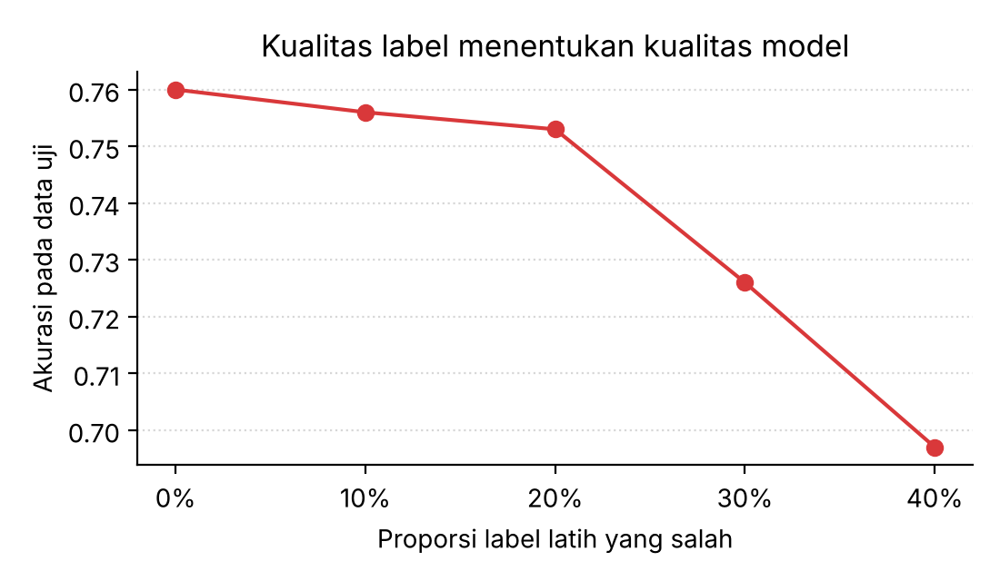
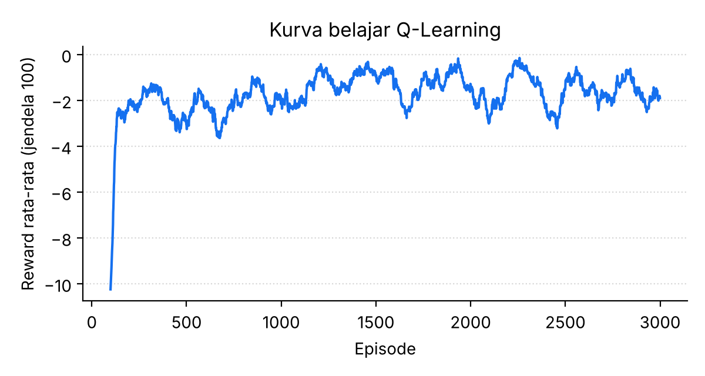
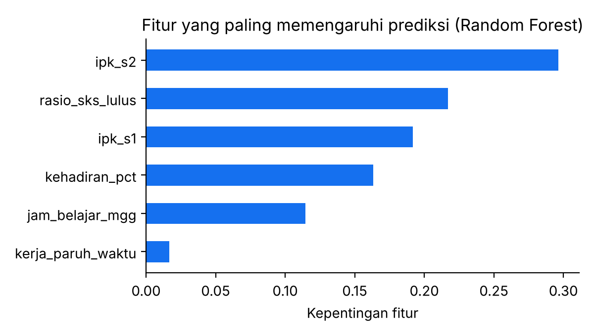
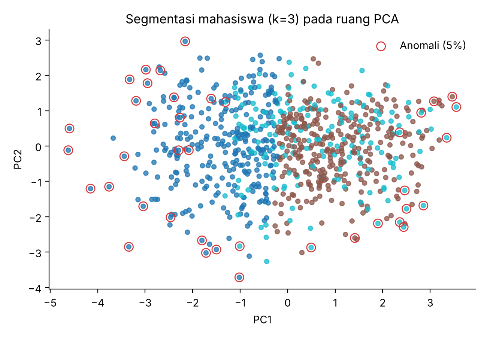

# Pertemuan 4 — Introduction to Machine Learning
**Studi Kasus:** Analitik Akademik Program Studi: Prediksi Kelulusan Tepat Waktu, Segmentasi Mahasiswa, dan Demo Empat Paradigma ML

**Identitas**
- Nama: Muhammad Yusuf Arrayyan
- NPM: G1A024009
- Program Studi: S1 Teknik Informatika, Universitas Bengkulu (UNIB)
- Kegiatan: Informatics Practitioner Lecture Series
- Narasumber: Dr. Tanzila Tahiddin, Senior Lecturer, Faculty of Computer and Mathematical Sciences, Universiti Teknologi MARA (UiTM), Malaysia (ejaan nama dan afiliasi dibaca dari catatan tulisan tangan; perlu dicek)

> Data mahasiswa pada notebook ini **sintetis** dan tidak berasal dari individu nyata.

## Ringkasan Materi
1. **Machine learning (ML)** adalah cabang AI yang membuat komputer belajar pola dari data tanpa diprogram aturan secara eksplisit.
2. **Empat paradigma ML:**
   - *Supervised*: belajar dari data berlabel (klasifikasi, regresi).
   - *Unsupervised*: menemukan struktur pada data tanpa label (klaster, reduksi dimensi, deteksi anomali).
   - *Semi-supervised*: memadukan sedikit data berlabel dengan banyak data tak berlabel.
   - *Reinforcement*: agen belajar lewat interaksi dan *reward*.
3. **Siklus ML:** pengumpulan data → persiapan data → pelatihan → pengujian → evaluasi dan *deployment*.
4. Prinsip **Garbage In, Garbage Out**: kualitas data dan label menentukan kualitas model.

## Latar Belakang
Program studi perguruan tinggi menyimpan data akademik mahasiswa (IPK per semester, kehadiran, SKS yang lulus, kegiatan di luar kuliah). Pengelola program studi ingin mengetahui **mahasiswa mana yang berisiko tidak lulus tepat waktu** sedini mungkin agar dosen wali dapat memberi pendampingan sebelum terlambat. Selain itu, pengelola ingin memahami **kelompok-kelompok mahasiswa** yang ada, memanfaatkan data yang **belum diberi label** (karena pelabelan mahal), dan melihat bagaimana sistem dapat belajar dari **umpan balik** (konsep reinforcement learning).

Kasus ini dipilih karena satu kumpulan data yang sama dapat dipakai untuk memperagakan hampir seluruh paradigma ML dari materi, sehingga perbedaan tujuan dan keterbatasan tiap paradigma terlihat jelas dalam satu cerita.

## Rumusan Masalah
1. Seberapa baik fitur akademik awal memprediksi kelulusan tepat waktu, dan model mana yang paling cocok?
2. Seberapa besar kesalahan label menurunkan kinerja model (*Garbage In, Garbage Out*)?
3. Apakah terdapat kelompok mahasiswa yang berbeda secara alami tanpa memakai label?
4. Apakah data tak berlabel membantu ketika label hanya tersedia untuk 10% data?
5. Bagaimana agen belajar mencapai tujuan dengan reward?

## Tujuan
1. Membangun dan membandingkan tiga model klasifikasi dengan validasi silang, lalu menguji pada data terpisah.
2. Membandingkan hasil dengan *baseline* sederhana agar kinerja model dinilai secara jujur.
3. Mengukur dampak label tercemar terhadap akurasi.
4. Menerapkan K-Means, PCA, dan Isolation Forest.
5. Membandingkan Label Spreading dengan model yang hanya memakai label yang tersedia.
6. Mengimplementasikan Q-Learning pada *grid world*.

## Dasar Teori
- **Klasifikasi:** memprediksi kategori (di sini lulus tepat waktu = 1 atau tidak = 0). Model yang dipakai: Logistic Regression (model linear, mudah ditafsirkan), Decision Tree (aturan bercabang), Random Forest (ansambel pohon).
- **Validasi silang 5-fold:** data latih dibagi 5 bagian, bergantian 4 bagian untuk melatih dan 1 untuk menguji, sehingga estimasi kinerja lebih stabil.
- **Metrik:** akurasi (proporsi benar), F1 (rata-rata harmonik presisi dan recall), matriks konfusi. **Baseline** mayoritas menunjukkan akurasi bila selalu menebak kelas terbanyak; model hanya berguna bila melampauinya.
- **K-Means dan silhouette:** K-Means membagi data ke k klaster; skor silhouette (−1 sampai 1) mengukur seberapa jelas klaster terpisah. **PCA** memproyeksikan data ke sumbu yang menangkap varians terbesar. **Isolation Forest** menandai titik yang mudah "diisolasi" sebagai anomali.
- **Label Spreading:** menyebarkan label dari titik berlabel ke tetangganya pada graf kesamaan.
- **Q-Learning:** `Q(s,a) ← Q(s,a) + α [r + γ · max Q(s',a') − Q(s,a)]`, dengan α laju belajar, γ faktor diskon, dan strategi ε-greedy untuk menyeimbangkan eksplorasi dan eksploitasi.

## Dataset
800 mahasiswa sintetis (seed 42) dengan fitur:
| Fitur | Arti |
|---|---|
| `ipk_s1`, `ipk_s2` | IPK semester 1 dan 2 |
| `kehadiran_pct` | persentase kehadiran |
| `jam_belajar_mgg` | jam belajar per minggu |
| `kerja_paruh_waktu` | 1 bila bekerja paruh waktu |
| `rasio_sks_lulus` | rasio SKS yang lulus |
| `lulus_tepat` | **target**: 1 bila lulus tepat waktu |

Target dibangkitkan dari fungsi logistik atas fitur ditambah keacakan, sehingga ada batas kemampuan prediksi (tidak mungkin 100%). Proporsi lulus tepat waktu sekitar **59,6%**.

## Metodologi
1. Eksplorasi data → 2. Supervised (3 model, CV 5-fold, uji, baseline, matriks konfusi) → 3. Eksperimen GIGO (label dibalik 0–40%, rata-rata 5 pengulangan) → 4. Unsupervised (K-Means, silhouette, PCA, Isolation Forest) → 5. Semi-supervised (10% label, 5 pengulangan) → 6. Reinforcement (Q-Learning 3.000 episode pada grid 5×5 dengan 4 sel bahaya).

## Implementasi
Setiap kelompok keluaran diikuti sel **Interpretasi** (angka berdasarkan seed bawaan).

> Laporan studi kasus ini dihasilkan otomatis dari narasi di `kode.py`. Kode lengkap: [`Pertemuan_4_Machine_Learning.ipynb`](../../Pertemuan_4_Machine_Learning.ipynb) ([buka di Colab](https://colab.research.google.com/github/YusufArrayyan/Informatics-Practiticioner-Lecturer-Series/blob/main/Pertemuan_4_Machine_Learning.ipynb)) dan [`kode.py`](kode.py). Panduan KNIME: [`KNIME_GUIDE.md`](KNIME_GUIDE.md).

## 1. Pengumpulan data (sintetis) & eksplorasi

### Interpretasi: eksplorasi data
- Rata-rata IPK semester 1 dan 2 sekitar 3,0; kehadiran rata-rata ±81%; jam belajar ±12 jam per minggu; ±29% mahasiswa bekerja paruh waktu.
- **Sekitar 59,6% mahasiswa lulus tepat waktu**, sehingga kelas cukup seimbang. Ini penting untuk memilih metrik: pada data seimbang, akurasi masih bermakna tetapi harus dibandingkan dengan baseline.

## 2. Supervised Learning: klasifikasi kelulusan tepat waktu
Tiga model dibandingkan dengan validasi silang 5-fold pada data latih lalu diuji pada data uji.

### Interpretasi: supervised learning
- **Baseline** (selalu menebak "lulus tepat waktu") menghasilkan akurasi uji **0,595**. Semua model melampauinya, jadi ada informasi yang berhasil dipelajari.
- Hasil data uji: Logistic Regression akurasi **0,780** (F1 0,821), Decision Tree 0,770 (F1 0,810), Random Forest 0,755 (F1 0,798). F1 validasi silang masing-masing 0,823; 0,783; 0,804.
- Model **paling sederhana (Logistic Regression) justru terbaik**. Karena target dibangkitkan dari hubungan hampir linear, model yang lebih kompleks tidak memberi keuntungan. Pelajaran: kompleksitas tidak otomatis lebih baik; pilih model sesuai struktur data.
- Matriks konfusi (baris = aktual, kolom = prediksi): 55 benar-tidak-lulus, 26 salah-prediksi-lulus, 18 salah-prediksi-tidak-lulus, 101 benar-lulus. Dari 119 mahasiswa yang benar-benar lulus tepat waktu, 101 (±85%) tertangkap. Untuk pendampingan, kesalahan yang paling merugikan adalah **mahasiswa berisiko yang diprediksi aman** (26 kasus), sehingga ambang keputusan sebaiknya disesuaikan bila recall kelas berisiko lebih penting.

### Eksperimen "Garbage In, Garbage Out": label tercemar
Sebagian label latih sengaja dibalik (kesalahan input), lalu model diuji pada label uji yang benar.

### Interpretasi: Garbage In, Garbage Out pada label
- Akurasi Random Forest (rata-rata 5 pengacakan) pada label latih yang dibalik secara acak: 0% → **0,760**, 10% → 0,756, 20% → 0,753, 30% → 0,726, 40% → **0,697**.
- Penurunan **tidak linear**: hampir datar hingga 20% label salah (Random Forest cukup tahan derau acak ringan), lalu menurun jelas pada 30–40%. Pada 40% label salah akurasi turun ±6 poin dan mendekati baseline 0,595.
- Derau di sini acak. Kesalahan label yang **sistematis** (mis. satu kelompok selalu salah dilabeli) jauh lebih merusak. Maka audit kualitas label tetap wajib sebelum pelatihan.

## 3. Unsupervised Learning: segmentasi, PCA, anomali
Label `lulus_tepat` **tidak dipakai**. Model mencari struktur sendiri dari fitur.

### Interpretasi: unsupervised learning
- Skor silhouette untuk k = 2 sampai 6 berkisar 0,186–0,215; **k = 3** dipilih (0,215, hampir sama dengan k = 2). Nilai ±0,2 tergolong rendah: segmen yang ditemukan **saling tumpang tindih**, bukan kelompok yang terpisah tegas. Hasil ini adalah alat bantu eksplorasi, bukan kebenaran mutlak.
- Profil tiga segmen: **segmen 0** (301 mahasiswa) IPK ±2,55 dan hanya ±35% lulus tepat waktu → kelompok prioritas pendampingan; **segmen 1** (310) IPK ±3,30 dengan ±84% lulus tepat waktu; **segmen 2** (189) IPK ±3,14 dengan ±59%. Label `lulus_tepat` **tidak dipakai** untuk klaster, tetapi segmen yang terbentuk ternyata berkaitan kuat dengannya.
- Nomor segmen bersifat sembarang (bergantung inisialisasi), yang bermakna adalah profilnya.
- Dua komponen PCA menjelaskan **58,7%** varians (37,5% + 21,2%), cukup untuk visualisasi dua dimensi, tetapi sisa 41% informasi tidak terlihat pada plot. Titik bertanda merah adalah 5% data yang dianggap anomali oleh Isolation Forest; anomali berarti "tidak lazim", belum tentu "salah".

## 4. Semi-supervised Learning: hanya 10% data berlabel
Label Spreading memanfaatkan struktur data tak berlabel. Pembanding: Logistic Regression yang hanya memakai data berlabel.
Hasil dilaporkan apa adanya; manfaat semi-supervised bergantung pada struktur data.

### Interpretasi: semi-supervised learning
- Dengan hanya 10% label, model yang hanya memakai label itu (Logistic Regression) mencapai akurasi rata-rata **0,766**, sedangkan **Label Spreading 0,689**. Acuan dengan 100% label adalah 0,780.
- Jadi pada data ini **memakai data tak berlabel tidak membantu, bahkan lebih buruk**. Penyebabnya: Label Spreading mengandalkan asumsi bahwa titik berdekatan memiliki label sama, padahal di data ini kelas tumpang tindih dan batas keputusannya linear.
- Hasil ini dilaporkan apa adanya. Pelajaran: semi-supervised bukan jaminan peningkatan; selalu bandingkan dengan pembanding sederhana. Menariknya, model linear dengan hanya 10% label (0,766) sudah mendekati model dengan seluruh label (0,780), tanda bahwa jumlah label yang dibutuhkan relatif sedikit untuk struktur sesederhana ini.

## 5. Reinforcement Learning: Q-Learning di grid world 5×5
Agen (misal robot pengantar logistik) belajar dari **reward**: +10 mencapai tujuan, −10 masuk zona bahaya, −1 tiap langkah.

### Interpretasi: reinforcement learning
- Setelah 3.000 episode, agen menemukan jalur greedy dari (0,0) ke tujuan (4,4) dalam **8 langkah**, yaitu jarak terpendek yang mungkin pada grid 5×5, tanpa menginjak satu pun sel bahaya (X). Peta panah menunjukkan kebijakan yang dipelajari di setiap sel.
- Perilaku ini muncul hanya dari reward (+10 tujuan, −10 bahaya, −1 per langkah) tanpa ada yang mengajarkan rute. **Desain reward menentukan perilaku**: tanpa penalti −1 per langkah, agen tidak punya alasan memilih rute terpendek.
- Berbeda dengan paradigma lain, RL tidak butuh dataset awal, tetapi butuh lingkungan untuk berinteraksi (simulator atau dunia nyata).

## Ringkasan
- **Supervised** butuh label berkualitas; kesalahan label langsung menurunkan akurasi.
- **Unsupervised** menemukan segmen & anomali tanpa label, tetapi interpretasi tetap tugas manusia.
- **Semi-supervised** berguna saat label mahal; periksa selalu terhadap pembanding sederhana.
- **Reinforcement** belajar lewat interaksi dan reward; desain reward menentukan perilaku agen.

## Hasil dan Pembahasan (ringkasan)
| Paradigma | Temuan utama |
|---|---|
| Supervised | Logistic Regression terbaik: akurasi uji 0,780 vs baseline 0,595 |
| Garbage In, Garbage Out | Akurasi 0,760 (label bersih) → 0,697 (40% label salah) |
| Unsupervised | k = 3 (silhouette ±0,215); satu segmen berisiko dengan ±35% lulus tepat waktu; PCA 2 komponen menangkap 58,7% varians |
| Semi-supervised | Label Spreading 0,689 lebih rendah dari supervised 10% label (0,766) |
| Reinforcement | Jalur 8 langkah optimal tanpa menginjak sel bahaya |

## Kesimpulan
1. Model sederhana yang sesuai struktur data bisa mengalahkan model kompleks; selalu bandingkan dengan baseline.
2. Kualitas label menentukan hasil: derau label ringan masih tertoleransi, derau besar menurunkan kinerja nyata.
3. Pembelajaran tanpa label menghasilkan segmen yang bermakna, tetapi kekuatan pemisahannya terbatas dan interpretasinya tugas manusia.
4. Semi-supervised hanya bermanfaat bila asumsi strukturnya terpenuhi.
5. Reinforcement learning belajar dari reward; merancang reward sama pentingnya dengan memilih algoritma.

## Keterbatasan
- Data sintetis dengan hubungan yang kita tentukan sendiri; hasil tidak mewakili kondisi mahasiswa sebenarnya.
- Satu pemisahan latih-uji (200 data uji) membuat selisih akurasi beberapa poin antarmodel belum tentu signifikan secara statistik.
- Prediksi risiko akademik pada manusia membawa isu etika (label stigma, bias, privasi) yang tidak dibahas dalam kode.
- Grid world RL sangat kecil dan deterministik.

## Saran Pengembangan
- Memakai data akademik nyata yang dianonimkan dan disetujui kampus; menambahkan fitur seperti keaktifan LMS.
- Menambahkan penjelasan model (koefisien, SHAP) dan kalibrasi probabilitas agar dosen wali dapat memahami alasan prediksi.
- Menguji ketidakseimbangan kelas dan menyetel ambang keputusan sesuai biaya kesalahan.
- Membangun alur yang sama di KNIME (Learner/Predictor, Scorer; lihat `KNIME_GUIDE.md`).

## Referensi
> Rujukan di bawah adalah bacaan lanjutan. Periksa kembali penulisan, tahun, dan volume sebelum dikutip dalam laporan resmi.
- Pedregosa, F., dkk. (2011). Scikit-learn: Machine Learning in Python. *JMLR*, 12, 2825–2830.
- Sutton, R. S., & Barto, A. G. (2018). *Reinforcement Learning: An Introduction* (2nd ed.). MIT Press.
- Watkins, C. J. C. H., & Dayan, P. (1992). Q-learning. *Machine Learning*, 8, 279–292.
- Zhou, D., dkk. (2004). Learning with local and global consistency (Label Spreading). *NIPS 16*.
- Rousseeuw, P. J. (1987). Silhouettes. *Journal of Computational and Applied Mathematics*, 20, 53–65.
- Liu, F. T., Ting, K. M., & Zhou, Z.-H. (2008). Isolation Forest. *IEEE ICDM*.
- Materi Practitioner Lecture Series, Pertemuan 4 (catatan kuliah).

## Lampiran: Gambar Hasil

**04_garbage_in_garbage_out**

**04_reinforcement_kurva_belajar**

**04_supervised_feature_importance**

**04_unsupervised_pca_segmen**

