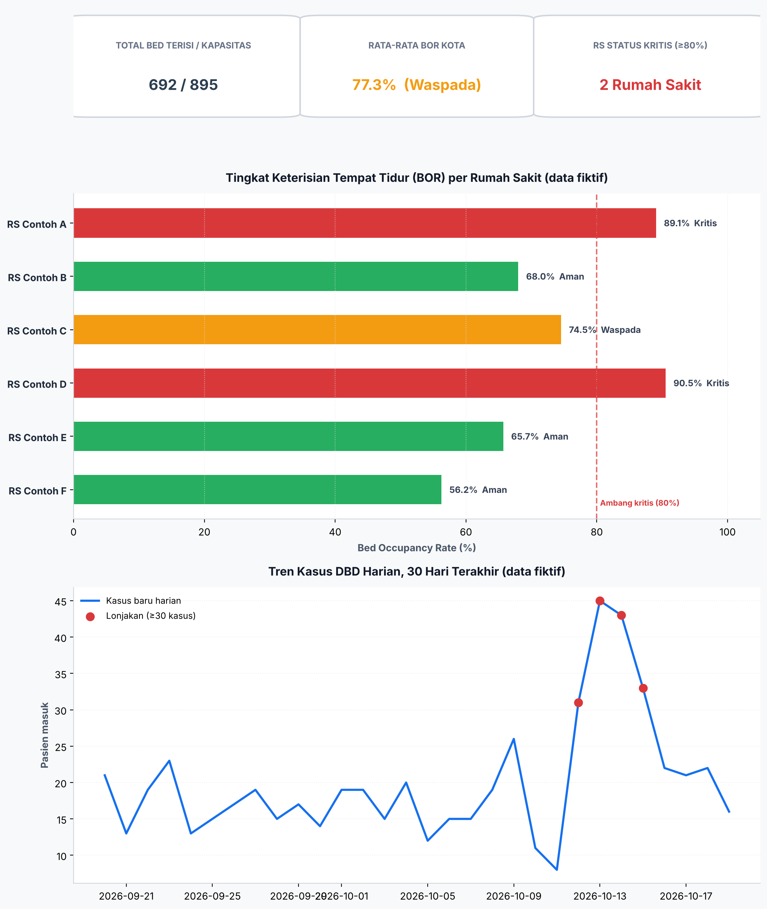
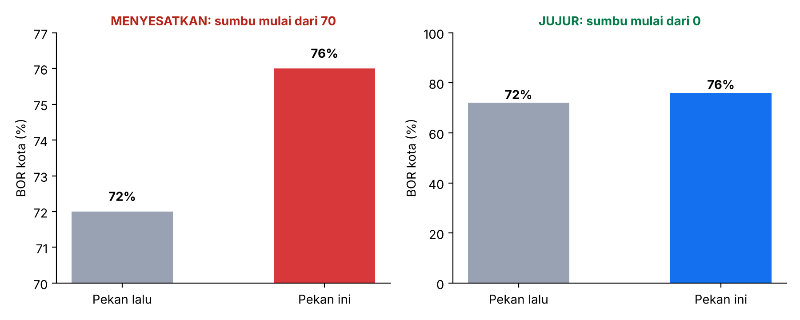

# Pertemuan 5 — Human-Computer Interaction (HCI) & Data Visualization
**Studi Kasus:** HealthViz-HCI, Dasbor Pemantauan Keterisian Tempat Tidur Rumah Sakit dan Tren Kasus DBD untuk Dinas Kesehatan Kota

**Identitas**
- Nama: Muhammad Yusuf Arrayyan
- NPM: G1A024009
- Program Studi: S1 Teknik Informatika, Universitas Bengkulu (UNIB)
- Kegiatan: Informatics Practitioner Lecture Series
- Narasumber: Dr. Arafat Febriandirza, S.T., M.T.I. (Ketua Kelompok Riset Interaksi Manusia Komputer dan Visualisasi, Pusat Riset Sains Data dan Informasi, BRIN)

> Nama rumah sakit dan angka hunian pada notebook ini **fiktif**, bukan data fasilitas kesehatan sebenarnya.

## Ringkasan Materi
1. **HCI** mempelajari bagaimana manusia berinteraksi dengan sistem; visualisasi data yang baik membantu orang memahami data dan memutuskan dengan cepat dan benar.
2. **Shneiderman's Mantra:** *overview first, zoom and filter, details on demand.*
3. **Tufte:** maksimalkan *data-ink ratio*, hindari *chartjunk* (3D, bayangan, grid pekat). Konsep *lie factor* mengukur seberapa jauh grafik melebih-lebihkan data.
4. **Prinsip persepsi:** hukum Gestalt (proximity, similarity, enclosure) dan atribut *preattentive* (warna, ukuran, posisi) yang ditangkap otak dalam hitungan milidetik.
5. **Desain interaksi (Norman):** feedback langsung, *affordance*, konsistensi.
6. **Aksesibilitas (WCAG, prinsip POUR):** *Perceivable, Operable, Understandable, Robust*; rasio kontras warna dan tidak mengandalkan warna saja.
7. **Etika desain:** menghindari *dark patterns* dan grafik menyesatkan; **usability testing** untuk memvalidasi desain.

## Latar Belakang
Saat terjadi lonjakan kasus demam berdarah (DBD), Dinas Kesehatan Kota harus cepat mengetahui **rumah sakit mana yang hampir penuh** dan **apakah kasus baru sedang melonjak**. Dasbor yang berantakan atau menyesatkan membuat petugas lambat atau salah mengambil keputusan, padahal situasinya darurat. Pengguna utamanya (misalnya Kepala Bidang Pencegahan dan Pengendalian Penyakit) membaca dasbor sambil terburu-buru dan tidak punya waktu mempelajari antarmuka.

Studi kasus ini merancang dasbor **HealthViz-HCI** dengan menerapkan prinsip HCI dan visualisasi dari materi, mengaudit aksesibilitasnya secara terukur, serta memperagakan bagaimana pilihan desain yang tidak etis (sumbu terpotong) dapat menyesatkan pembaca.

## Rumusan Masalah
1. Bagaimana menyajikan status keterisian tempat tidur sehingga RS kritis terlihat dalam hitungan detik?
2. Bagaimana menerapkan prinsip Tufte, Gestalt, dan Shneiderman pada dasbor statis dan interaktif?
3. Apakah palet warna yang dipakai memenuhi standar kontras WCAG?
4. Seberapa besar sumbu grafik yang terpotong dapat memutarbalikkan persepsi data?
5. Bagaimana mengevaluasi kualitas usability dasbor?

## Tujuan
1. Membuat dasbor statis (matplotlib) dan dasbor web interaktif mandiri (HTML/JS tanpa dependensi).
2. Mengaudit kontras warna terhadap ambang WCAG 2.1 (3:1 grafis, 4,5:1 teks).
3. Menghitung *lie factor* pada contoh grafik menyesatkan.
4. Mengevaluasi dasbor dengan *heuristic evaluation* Nielsen dan menyusun rencana usability testing.

## Dasar Teori
- **BOR (Bed Occupancy Rate)** = bed terisi / total bed × 100%. Ambang pada studi kasus (asumsi demonstrasi): ≥80% **Kritis**, 70–<80% **Waspada**, <70% **Aman**.
- **Rasio kontras WCAG** = `(L1 + 0,05) / (L2 + 0,05)`, dengan L luminans relatif (L1 warna lebih terang). WCAG 2.1 meminta ≥3:1 untuk komponen grafis dan ≥4,5:1 untuk teks biasa.
- **Lie factor (Tufte)** = (besar efek yang tampak pada grafik) / (besar efek pada data). Nilai ideal 1.
- **Heuristic evaluation (Nielsen):** pemeriksaan antarmuka terhadap sepuluh heuristik usability seperti visibilitas status sistem, konsistensi, pencegahan galat, dan estetika minimalis.

## Dataset
- **6 rumah sakit fiktif** (RS Contoh A–F) di 5 wilayah dengan total bed dan bed terisi.
- **Tren 30 hari kasus DBD baru** (20 September–19 Oktober 2026) dibangkitkan Poisson (λ = 18) dengan lonjakan buatan pada empat hari berturut-turut (+15, +22, +28, +20 kasus).

## Metodologi
1. Hitung BOR dan status tiap RS → 2. Dasbor statis (KPI, bar horizontal berurut, tren dengan anotasi lonjakan) → 3. Audit kontras warna → 4. Demo lie factor → 5. Dasbor web interaktif (filter wilayah, KPI dihitung ulang, hover untuk detail) → 6. Heuristic evaluation.

## Implementasi
Setiap kelompok keluaran diikuti sel **Interpretasi**.

> Laporan studi kasus ini dihasilkan otomatis dari narasi di `kode.py`. Kode lengkap: [`Pertemuan_5_HCI_Visualisasi_Data.ipynb`](../../Pertemuan_5_HCI_Visualisasi_Data.ipynb) ([buka di Colab](https://colab.research.google.com/github/YusufArrayyan/Informatics-Practiticioner-Lecturer-Series/blob/main/Pertemuan_5_HCI_Visualisasi_Data.ipynb)) dan [`kode.py`](kode.py). Panduan KNIME: [`KNIME_GUIDE.md`](KNIME_GUIDE.md).

## 1. Data sintetis

### Interpretasi: kondisi keterisian
- **BOR kota 77,3%** (692 dari 895 bed terisi), masuk kategori Waspada.
- **Dua RS berstatus Kritis:** RS Contoh D (90,5%; Ratu Samban) dan RS Contoh A (89,1%; Gading Cempaka). RS Contoh C (74,5%) Waspada; B, E, dan F Aman (56,2–68,0%).
- Angka kota yang tampak "waspada" bisa menutupi masalah di tingkat RS: dua RS sudah hampir penuh sementara RS lain masih longgar. Ini alasan dasbor harus menampilkan **overview kota sekaligus rincian per RS**, bukan hanya rata-rata.

## 2. Dasbor statis: Overview first + Tufte + Gestalt

## 3. Audit aksesibilitas: kontras warna (WCAG, prinsip *Perceivable*)
Rasio kontras warna grafis terhadap latar putih. WCAG 2.1 meminta ≥ 3:1 untuk komponen grafis dan ≥ 4,5:1 untuk teks biasa.

### Interpretasi: audit aksesibilitas warna
- Rasio kontras terhadap latar putih: Kritis (merah `#D9383A`) **4,59** dan biru tren (`#1570EF`) **4,57**, keduanya lulus 3:1 dan 4,5:1. Waspada (oranye `#F39C12`) hanya **2,19** dan Aman (hijau `#27AE60`) **2,87**, keduanya **gagal** 3:1.
- Konsekuensinya, oranye dan hijau yang tipis pada latar putih sulit dilihat oleh pengguna dengan penglihatan rendah. Perbaikan: gelapkan warna (mis. oranye dan hijau yang lebih pekat) atau pakai garis tepi/ikon.
- Prinsip penting lain: **status tidak boleh bergantung pada warna saja**. Dasbor selalu menambahkan label teks ("Kritis", "Waspada", "Aman"), sehingga tetap terbaca oleh pengguna buta warna merah-hijau. Audit ini mengubah "kelihatannya cukup jelas" menjadi pemeriksaan yang terukur.

## 4. Ethical design: demo *lie factor* (sumbu terpotong)
Dua grafik memakai data yang sama. Sumbu terpotong membuat selisih kecil tampak dramatis.

### Interpretasi: etika visualisasi
- BOR naik dari 72% ke 76% atau **+5,6%** pada data. Pada grafik dengan sumbu yang dimulai dari 70, tinggi batang tampak naik **+200%**, sehingga **lie factor ≈ 36** (idealnya 1).
- Data dan batangnya sama; yang berbeda hanya titik awal sumbu. Grafik kiri membuat kenaikan kecil tampak seperti krisis dan dapat memicu panik atau keputusan keliru, sedangkan grafik kanan (sumbu mulai 0) memberi proporsi yang jujur.
- Aturan praktis: untuk **grafik batang**, sumbu harus mulai dari nol karena tinggi batang mewakili besaran. Untuk grafik garis, sumbu boleh tidak dimulai dari nol selama dinyatakan jelas.

## 5. Dasbor web interaktif (Zoom & Filter + Details-on-Demand)
File HTML mandiri tanpa dependensi. Saat filter kecamatan diubah, **kartu KPI ikut dihitung ulang** (prinsip *feedback* Norman).
Hover pada titik grafik tren menampilkan rincian per tanggal (*details-on-demand*).

### Interpretasi: dasbor interaktif
- Berkas `healthviz_dashboard_interactive.html` berdiri sendiri (tanpa pustaka luar) dan dapat dibuka di peramban. Menerapkan **zoom and filter**: memilih wilayah pada dropdown memperbarui tabel RS dan **kartu KPI ikut dihitung ulang** (prinsip *feedback* Norman; area KPI ditandai `aria-live` agar pembaca layar mengumumkan perubahan).
- Hover pada titik tren menampilkan rincian per tanggal (**details-on-demand**); hari dengan ≥30 kasus ditandai sebagai lonjakan. Kontrol dibuat cukup besar (tinggi minimal 44 px) dan dapat dioperasikan dengan papan ketik, selaras dengan prinsip *Operable*.

## 6. Evaluasi usability (Heuristic Evaluation Nielsen, ringkas)
| Heuristik | Penerapan di HealthViz-HCI | Status |
|---|---|---|
| Visibility of system status | KPI selalu tampil & berubah saat filter | ✔ |
| Recognition over recall | Label teks pada status, tanpa legenda tersembunyi | ✔ |
| Consistency | Warna status sama di bar, badge, dan KPI | ✔ |
| Error prevention | Filter berupa pilihan tertutup | ✔ |
| Aesthetic & minimalist | Tanpa 3D, bayangan, atau grid pekat | ✔ |
| Accessibility | Redundansi teks; kontras diaudit; kontrol dapat dioperasikan papan ketik | ⚠ oranye & hijau gagal 3:1 pada audit; perlu digelapkan |

Langkah berikut yang disarankan materi: **usability testing** dengan persona (Kepala Bidang P2P) pada skenario
"temukan RS kritis dalam <5 detik" dan ukur *success rate* serta waktu tugas.

## Hasil dan Pembahasan (ringkasan)
| Aspek | Temuan |
|---|---|
| Keterisian | BOR kota 77,3%; 2 dari 6 RS Kritis (D 90,5%, A 89,1%) |
| Kontras warna | Merah 4,59 dan biru 4,57 lulus; oranye 2,19 dan hijau 2,87 gagal 3:1 |
| Lie factor | Kenaikan nyata +5,6% tampak +200% pada sumbu terpotong (lie factor ≈ 36) |
| Dasbor interaktif | Filter wilayah dengan KPI dinamis dan detail saat hover |

## Kesimpulan
1. Dasbor yang baik menempatkan informasi terpenting (RS kritis) pada tingkat visual tertinggi dan mengurangi beban kognitif lewat hirarki dan warna yang hemat.
2. Aksesibilitas dapat diukur, bukan sekadar perasaan. Audit menemukan dua warna status yang perlu diperbaiki.
3. Pilihan desain grafik bersifat etis: sumbu terpotong dapat memutarbalikkan persepsi puluhan kali lipat.
4. Evaluasi heuristik menunjukkan desain memenuhi sebagian besar heuristik, dengan catatan terbuka pada kontras oranye dan hijau.

## Keterbatasan
- Data fiktif dan hanya 6 RS; ambang BOR hanyalah asumsi demonstrasi (bukan standar Kemenkes).
- Evaluasi usability dilakukan sebagai heuristic evaluation internal; belum ada pengujian dengan pengguna nyata.
- Perbaikan warna yang gagal 3:1 dan pengujian buta warna (simulator) belum diterapkan.

## Saran Pengembangan
- Menggelapkan warna Waspada dan Aman hingga lulus 3:1 dan menambahkan ikon atau pola sebagai pembeda.
- Melakukan **usability testing** dengan persona Kepala Bidang P2P: tugas "temukan RS kritis dalam <5 detik", ukur *success rate* dan waktu tugas.
- Menyambungkan dasbor ke sumber data nyata (SIRS Online/Dinkes) dengan pembaruan berkala dan menambahkan notifikasi ambang kritis.
- Membangun versi di KNIME/Tableau/Power BI sebagai pembanding (lihat `KNIME_GUIDE.md`).

## Referensi
> Rujukan di bawah adalah bacaan lanjutan. Periksa kembali penulisan, tahun, dan volume sebelum dikutip dalam laporan resmi.
- Shneiderman, B. (1996). The eyes have it: A task by data type taxonomy for information visualizations. *IEEE Symposium on Visual Languages*.
- Tufte, E. R. (2001). *The Visual Display of Quantitative Information* (2nd ed.). Graphics Press.
- Norman, D. A. (2013). *The Design of Everyday Things* (rev. ed.). Basic Books.
- W3C (2018). *Web Content Accessibility Guidelines (WCAG) 2.1*.
- Nielsen, J. (1994). *10 Usability Heuristics for User Interface Design*. Nielsen Norman Group.
- Ware, C. (2012). *Information Visualization: Perception for Design*. Morgan Kaufmann.
- Materi Practitioner Lecture Series, Pertemuan 5 (dokumen ringkasan).

## Lampiran: Gambar Hasil

**05_dasbor_statis**

**05_lie_factor**

