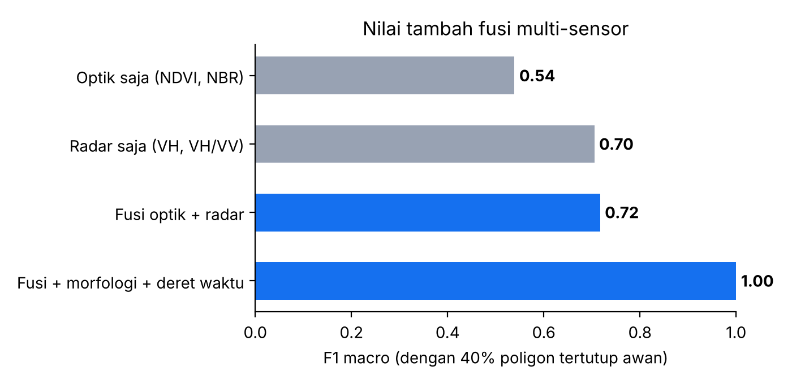
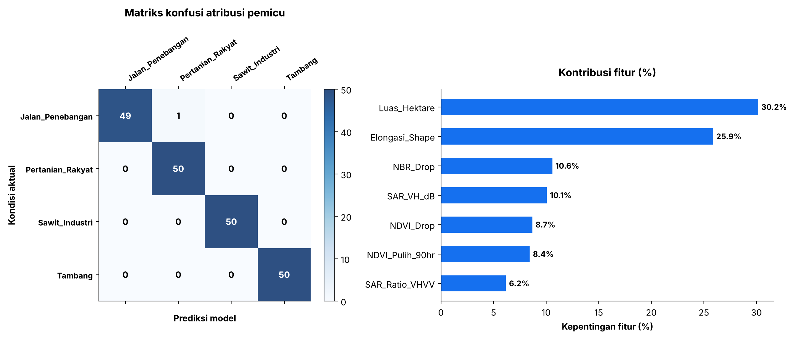

# Pertemuan 6 — Attributing Direct Drivers to Deforestation Alerts with Satellite Imagery and AI
**Studi Kasus:** Sistem Atribusi Pemicu Langsung Deforestasi untuk Balai Penegakan Hukum Kehutanan di Bengkulu

**Identitas**
- Nama: Muhammad Yusuf Arrayyan
- NPM: G1A024009
- Program Studi: S1 Teknik Informatika, Universitas Bengkulu (UNIB)
- Kegiatan: Informatics Practitioner Lecture Series
- Narasumber: Dr. Bart Slagter (Laboratory of Geo-Information Science and Remote Sensing, Wageningen University & Research)
- Waktu: Senin, 19 Oktober 2026, 14.00 WIB

> Data pada notebook ini **sintetis** (rentang fitur dirancang dari karakteristik umum tiap pemicu). Akurasi tidak mencerminkan performa pada citra nyata, dan lokasi alert pada bagian akhir adalah simulasi.

## Ringkasan Materi
1. Sistem peringatan dini seperti **RADD** (radar Sentinel-1) dan **Global Forest Watch** menjawab pertanyaan **"di mana dan kapan"** hutan hilang, tetapi belum **"mengapa"**. **Atribusi pemicu langsung** (sawit industri, pertanian rakyat, tambang, jalan penebangan) menentukan respons yang tepat.
2. **Fusi multi-sensor:** optik Sentinel-2 (indeks NDVI dan NBR) kaya informasi tetapi terhalang awan; radar Sentinel-1 (backscatter VH, rasio VH/VV) menembus awan dan memberi informasi struktur.
3. **Fitur tambahan:** morfologi poligon (luas, elongasi/bentuk memanjang) dan **deret waktu pascagangguan** (kecepatan pemulihan vegetasi).
4. Metode: ML klasik (Random Forest) hingga *deep learning* (CNN, U-Net, Transformer); tantangan utama **class imbalance** dan kebutuhan data latih beranotasi ahli.
5. Arah lanjutan: *Edge AI* untuk drone dan gawai lapangan, serta antarmuka yang ramah petugas.

## Latar Belakang
Hutan di Bengkulu dan sekitarnya mengalami tekanan dari ekspansi perkebunan, pembukaan lahan masyarakat, tambang, dan pembalakan. Sistem satelit menghasilkan banyak peringatan kehilangan tutupan, tetapi petugas lapangan terbatas. Tanpa mengetahui **apa pemicunya**, patroli sulit diprioritaskan: bukaan pertanian rakyat berskala kecil tentu ditangani berbeda dengan bukaan tambang atau jalan penebangan baru di dalam hutan lindung, yang menandakan potensi kegiatan ilegal.

Studi kasus ini membangun prototipe **model atribusi pemicu** yang mengubah setiap alert menjadi label pemicu beserta tingkat keyakinan, lalu menerjemahkannya menjadi **rekomendasi prioritas patroli**. Studi kasus juga menguji dua pertanyaan dari materi: mengapa fusi radar-optik diperlukan di wilayah tropis berawan, dan apa dampak ketidakseimbangan kelas.

## Rumusan Masalah
1. Fitur apa yang membedakan keempat pemicu deforestasi?
2. Seberapa akurat model dapat mengatribusikan pemicu dari fitur gabungan?
3. Bagaimana kinerja ketika sebagian citra optik hilang karena awan, dan apa peran radar?
4. Bagaimana kelas langka (tambang) memengaruhi model dan metrik yang perlu dipantau?
5. Bagaimana prediksi model diterjemahkan menjadi prioritas tindakan secara bertanggung jawab?

## Tujuan
1. Membangun dataset sintetis alert dengan tujuh fitur multi-sensor, morfologi, dan deret waktu.
2. Melatih dan mengevaluasi Random Forest (presisi, recall, F1, matriks konfusi, kontribusi fitur).
3. Menjalankan **ablasi fitur** dengan 40% data optik hilang.
4. Mengukur dampak class imbalance dan penanganannya.
5. Membuat aturan keputusan berbasis probabilitas untuk prioritas patroli.

## Dasar Teori
- **NDVI** = (NIR − Red)/(NIR + Red): ukuran kehijauan vegetasi; **NBR** = (NIR − SWIR)/(NIR + SWIR): sensitif terhadap lahan terbuka dan bekas terbakar. Yang dipakai adalah penurunannya (*drop*) sebelum dan sesudah kejadian.
- **Radar SAR (Sentinel-1):** backscatter VH (dB) sensitif terhadap struktur kanopi; rasio VH/VV membantu membedakan permukaan. Radar aktif sehingga bekerja menembus awan dan malam hari.
- **Karakter pemicu (asumsi dalam data sintetis):** sawit industri → bukaan luas dengan nilai `Elongasi_Shape` tinggi; pertanian rakyat → kecil, vegetasi pulih cepat; tambang → penurunan NDVI/NBR terdalam dan hampir tidak pulih; jalan penebangan → bukaan sempit dengan nilai `Elongasi_Shape` terendah (skala fitur ini ditentukan di kode).
- **Random Forest** untuk klasifikasi multikelas; **F1 makro** merata-ratakan F1 tiap kelas (adil terhadap kelas langka); **recall** kelas langka mengukur seberapa banyak kasus penting yang tertangkap.
- **Class imbalance:** kelas langka cenderung diabaikan model; penanganan umum: `class_weight`, *resampling*, atau pengumpulan data tambahan.

## Dataset
1.000 alert sintetis (250 per pemicu), tujuh fitur:
| Kelompok | Fitur |
|---|---|
| Morfologi | `Luas_Hektare`, `Elongasi_Shape` |
| Optik | `NDVI_Drop`, `NBR_Drop` |
| Radar | `SAR_VH_dB`, `SAR_Ratio_VHVV` |
| Deret waktu | `NDVI_Pulih_90hr` |

Nilai tiap kelas diambil dari rentang yang dirancang, lalu ditambah **derau pengukuran** agar kelas saling tumpang tindih. Kelas `Tambang` hanya berarti "bukaan tambang terdeteksi"; legal atau ilegalnya harus dicek pada data izin (overlay IUP).

## Metodologi
1. Bangun dataset → 2. Latih Random Forest (split 80/20 berstrata) dan evaluasi → 3. Ablasi: 40% poligon kehilangan data optik (diimputasi median), bandingkan optik saja, radar saja, fusi, dan fusi lengkap → 4. Class imbalance: kelas Tambang diperkecil menjadi 24 sampel latih, bandingkan tanpa dan dengan `class_weight='balanced'` → 5. Matriks konfusi dan kontribusi fitur → 6. Inferensi tiga alert simulasi dengan aturan prioritas.

## Implementasi
Setiap kelompok keluaran diikuti sel **Interpretasi**.

> Laporan studi kasus ini dihasilkan otomatis dari narasi di `kode.py`. Kode lengkap: [`Pertemuan_6_Deforestasi_Satelit_AI.ipynb`](../../Pertemuan_6_Deforestasi_Satelit_AI.ipynb) ([buka di Colab](https://colab.research.google.com/github/YusufArrayyan/Informatics-Practiticioner-Lecturer-Series/blob/main/Pertemuan_6_Deforestasi_Satelit_AI.ipynb)) dan [`kode.py`](kode.py). Panduan KNIME: [`KNIME_GUIDE.md`](KNIME_GUIDE.md).

## 1. Dataset sintetis peringatan deforestasi
Fitur: luas (ha), elongasi bentuk, penurunan NDVI & NBR (optik), backscatter VH & rasio VH/VV (radar),
dan **pemulihan NDVI 90 hari** (fitur deret waktu).
Catatan: kelas `Tambang` hanya menyatakan *bukaan tambang terdeteksi*; status legal/ilegal perlu dicek ke data izin (overlay IUP).

### Interpretasi: karakter tiap pemicu
- Dataset seimbang: 250 alert per pemicu.
- Rata-rata fitur sesuai karakter yang dirancang. **Sawit industri**: luas ±49,8 ha dan elongasi tinggi (0,82). **Pertanian rakyat**: luas ±1,9 ha dan pemulihan NDVI tertinggi (0,40). **Tambang**: penurunan NDVI terdalam (0,77), backscatter VH terendah (−20,4 dB), dan pemulihan nyaris nol (0,04). **Jalan penebangan**: `Elongasi_Shape` terendah (0,17) dengan luas ±6,7 ha.
- Tidak ada satu fitur yang memisahkan semua kelas; pembeda berbeda untuk tiap pasangan, sehingga fitur perlu digabungkan.

## 2. Pelatihan model atribusi (Random Forest) & evaluasi

### Interpretasi: evaluasi model atribusi
- Akurasi pada 200 data uji **99,5%** (hanya 1 kesalahan: satu jalan penebangan terprediksi pertanian rakyat); F1 makro 0,995.
- Fitur paling berkontribusi: **Luas_Hektare 30,2%** dan **Elongasi_Shape 25,9%**, disusul NBR_Drop 10,6%, SAR_VH_dB 10,1%, NDVI_Drop 8,7%, NDVI_Pulih_90hr 8,4%, dan SAR_Ratio_VHVV 6,2%. Bentuk dan ukuran poligon paling membedakan pada data ini.
- **Peringatan:** akurasi hampir sempurna terjadi karena data sintetis dirancang mudah dipisahkan. Pada citra nyata, kelas saling tumpang tindih jauh lebih besar dan angka sebesar ini tidak boleh diharapkan.

## 3. Mengapa fusi multi-sensor? Ablasi dengan tutupan awan
Di hutan tropis, sebagian citra optik tertutup awan. Kita simulasikan **40% poligon** tanpa data optik (NaN),
lalu bandingkan: optik saja, radar saja, dan fusi optik + radar (+ morfologi + deret waktu).
Nilai optik yang hilang diisi median (imputasi sederhana).

### Interpretasi: ablasi fusi multi-sensor (40% optik tertutup awan)
- F1 makro: **optik saja 0,539**, **radar saja 0,705**, **fusi optik + radar 0,717**, **fusi + morfologi + deret waktu 1,000**.
- Saat awan menutup sebagian besar citra optik, **optik saja turun paling jauh**; radar tetap stabil karena tidak terpengaruh awan, dan menggabungkannya dengan optik memberi sedikit tambahan. Inilah alasan fusi multi-sensor penting di hutan tropis.
- Skor 1,000 pada baris terakhir terjadi karena fitur morfologi memisahkan kelas hampir sempurna pada data sintetis. Pesan yang ingin ditunjukkan adalah **radar menjaga kinerja saat optik hilang**, bukan bahwa 1,000 dapat dicapai pada data nyata.

## 4. Tantangan class imbalance
Di lapangan, tambang liar jauh lebih jarang daripada ladang kecil. Kita buat data latih dengan kelas `Tambang`
hanya ±8% dan bandingkan **recall** kelas itu antara model biasa dan `class_weight="balanced"`.

### Interpretasi: class imbalance
- Data latih sengaja dibuat tidak seimbang: 200 sampel untuk tiga kelas dan hanya **24 untuk Tambang**.
- Tanpa penyeimbangan: recall Tambang **0,98**, F1 makro 0,995. Dengan `class_weight='balanced'`: recall Tambang **0,92**, F1 makro 0,980.
- Pada data sintetis yang mudah dipisahkan, ketidakseimbangan hampir tidak merugikan, dan pembobotan justru menukar sedikit presisi (bahkan sedikit menurunkan recall) di sini. Hasil ini dilaporkan apa adanya.
- Pada citra nyata dengan kelas tumpang tindih, kelas langka biasanya jauh lebih terabaikan, sehingga **recall kelas langka harus selalu dipantau secara terpisah**, bukan hanya akurasi total (akurasi tinggi bisa menyembunyikan kelas penting yang terlewat).

## 5. Matriks konfusi & kontribusi fitur

## 6. Inferensi pada peringatan baru (SIMULASI) + prioritas patroli
Rekomendasi memakai **probabilitas** dan ambang keyakinan: prediksi dengan keyakinan rendah diarahkan ke verifikasi
citra resolusi tinggi, bukan langsung ke tindakan lapangan.

### Interpretasi: dari prediksi ke prioritas patroli
- **Alert A (penyangga hutan lindung):** Sawit_Industri (keyakinan 99,9%) → Prioritas 2: pantau dengan citra resolusi tinggi.
- **Alert B (koridor di dalam hutan):** Jalan_Penebangan (100%) → **Prioritas 1**: koordinasi penegakan hukum untuk verifikasi lapangan (cek izin).
- **Alert C (bantaran sungai):** Tambang (100%) → **Prioritas 1**: verifikasi lapangan dan cek izin IUP.
- Aturan keputusan memakai **probabilitas**: bila keyakinan <60%, alert diarahkan ke verifikasi citra resolusi tinggi sebelum menerjunkan tim. Prediksi model adalah **petunjuk prioritas, bukan bukti hukum**; tindakan hukum memerlukan verifikasi lapangan dan data perizinan.
- Keyakinan sangat tinggi (99,9–100%) di sini mencerminkan data sintetis yang mudah; model nyata cenderung kurang yakin dan memerlukan kalibrasi probabilitas.

## Ringkasan
- Atribusi pemicu mengubah peringatan "di mana & kapan" menjadi informasi "mengapa", sehingga patroli lebih terarah.
- Radar menjaga performa saat optik tertutup awan; fusi dan fitur deret waktu menambah daya pembeda.
- Class imbalance perlu ditangani (bobot kelas, resampling) dan dievaluasi lewat recall kelas langka.
- Prediksi model = **petunjuk prioritas**, bukan bukti hukum: butuh verifikasi lapangan dan data perizinan.
- Arah riset lanjutan dari materi: Edge AI untuk drone/gawai, CNN/U-Net/Transformer pada citra asli, serta dasbor
  yang ramah polisi hutan (lihat Pertemuan 5).

## Hasil dan Pembahasan (ringkasan)
| Analisis | Temuan |
|---|---|
| Model atribusi | Akurasi 99,5% (data sintetis); fitur teratas luas (30,2%) dan elongasi (25,9%) |
| Ablasi 40% tertutup awan | F1 makro: optik 0,54; radar 0,71; fusi 0,72; fusi lengkap 1,00 |
| Class imbalance | Recall Tambang 0,98 (tanpa penyeimbangan) vs 0,92 (class_weight balanced) |
| Prioritas patroli | Tambang dan jalan penebangan → Prioritas 1; sawit → Prioritas 2; keyakinan <60% → verifikasi |

## Kesimpulan
1. Atribusi pemicu mengubah peringatan "di mana dan kapan" menjadi informasi "mengapa", sehingga patroli lebih terarah.
2. Radar menjaga kinerja ketika optik tertutup awan; fusi dan fitur morfologi serta deret waktu menambah daya pembeda.
3. Class imbalance perlu dievaluasi lewat recall kelas langka, bukan hanya akurasi total.
4. Keluaran model adalah petunjuk prioritas yang harus diverifikasi lapangan dan dicocokkan dengan data perizinan, bukan bukti hukum.

## Keterbatasan
- Seluruh data sintetis dan mudah dipisahkan, sehingga akurasi mendekati sempurna; tidak mencerminkan kinerja pada citra nyata.
- Model tabular (ringkasan fitur per poligon), bukan CNN/U-Net atas citra; informasi spasial dan konteks lanskap tidak dimanfaatkan.
- Tidak ada validasi spasial (uji pada wilayah berbeda) maupun kalibrasi probabilitas.
- Label `Tambang` tidak membedakan legal dan ilegal.

## Saran Pengembangan
- Menggunakan data nyata beranotasi seperti **ForestNet** dan alert RADD/GLAD melalui Google Earth Engine; validasi dengan survei lapangan.
- Mencoba CNN/U-Net atau Transformer pada potongan citra Sentinel-1/2 dan deret waktu panjang.
- Menambahkan overlay izin (IUP, HGU), batas kawasan hutan, dan jaringan jalan sebagai fitur kontekstual.
- Menyiapkan antarmuka dasbor untuk petugas (lihat Pertemuan 5) dan eksplorasi *Edge AI* di perangkat lapangan.

## Referensi
> Rujukan di bawah adalah bacaan lanjutan. Periksa kembali penulisan, tahun, dan volume sebelum dikutip dalam laporan resmi.
- Reiche, J., dkk. (2021). Combining satellite data for better tropical forest monitoring (RADD alerts). *Nature Climate Change*, 11, 1–3.
- Hansen, M. C., dkk. (2013). High-resolution global maps of 21st-century forest cover change. *Science*, 342, 850–853.
- Irvin, J., dkk. (2020). ForestNet: Classifying drivers of deforestation in Indonesia using deep learning on satellite imagery. *NeurIPS Workshop on Tackling Climate Change with ML*.
- Global Forest Watch (globalforestwatch.org).
- Breiman, L. (2001). Random Forests. *Machine Learning*, 45(1), 5–32.
- Materi Practitioner Lecture Series, Pertemuan 6 (dokumen ringkasan).

## Lampiran: Gambar Hasil

**06_ablasi_fusi_sensor**

**06_evaluasi_model**

